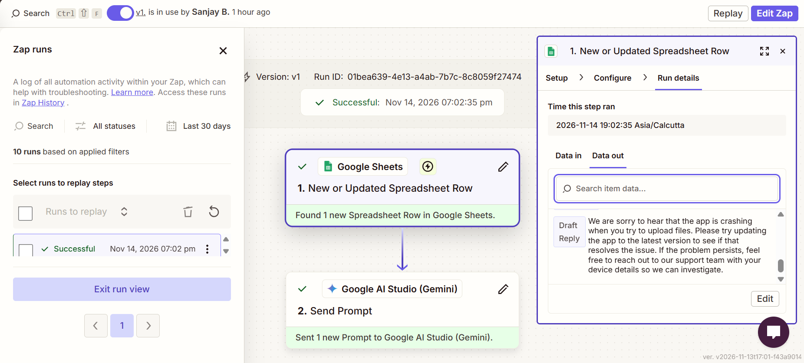
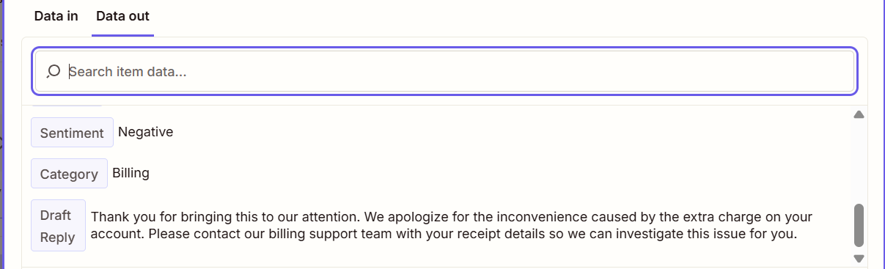
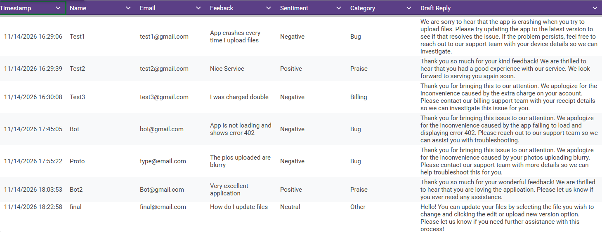
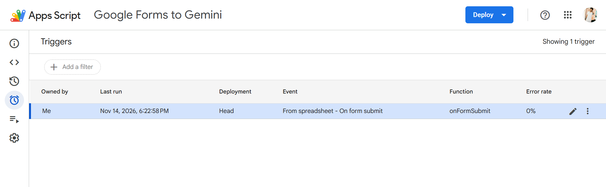

# AI Feedback Classifier

Google Form → Google Sheet → Apps Script → Gemini API → results back in the Sheet.

An AI-assisted workflow that reads customer feedback, tags its sentiment and category, and drafts a polite reply for human review.

## What it does
When someone submits the feedback form, an Apps Script trigger sends the text to the Gemini API with a structured prompt. The model returns three things, written back to the same row:

| Column | Content |
|---|---|
| Sentiment | Positive, Neutral or Negative |
| Category | Bug, Billing, Feature Request, Praise or Other |
| Draft Reply | A polite reply of 3 sentences or fewer |

Replies are **drafts for human review**. Nothing is sent to customers automatically.

## How it works
1. A customer submits the Google Form (Name, Email, Feedback).
2. Google adds the response as a new row in the linked Sheet.
3. The `onFormSubmit` trigger runs `analyzeRow` for that row.
4. The script builds the prompt, calls the Gemini API and parses the JSON reply.
5. Sentiment, Category and Draft Reply are written into columns E to G.
6. The row is wrapped and resized so the full reply is visible.

## Setup
1. Create a Google Form with Name, Email and Feedback, and link it to a Sheet.
2. In the Sheet, set row 1 headers: `Timestamp | Name | Email | Feedback | Sentiment | Category | Draft Reply`.
3. Open **Extensions → Apps Script** and paste the contents of `apps-script/Code.gs`.
4. Get a free API key at [aistudio.google.com](https://aistudio.google.com).
5. In **Project Settings → Script Properties**, add `GEMINI_KEY` with your key. Never put the key in the code.
6. Add a trigger: function `onFormSubmit`, deployment **Head**, event source **From spreadsheet**, event type **On form submit**.
7. Submit a test response from the form's live link and check the Sheet.

To fill rows that already existed, run `processAll` once manually. To format old rows, run `formatAll` once.

## Prompt design
- Gives the model a clear role (customer support analyst).
- Requires strict JSON output with fixed keys and allowed values.
- Handles sarcasm by judging real meaning.
- Falls back to Neutral / Other when unsure.
- Forbids inventing refunds, promises or facts.

See [prompts.md](prompts.md) for the versions and what changed.

## Reliability
- Retries once when the model is busy (HTTP 500/503).
- Stops immediately on quota errors (HTTP 429) instead of wasting calls.
- Writes errors into the Sheet instead of failing silently.
- Skips empty rows and rows already processed.

## Limitations
- Free-tier rate limits cap how many responses can be processed.
- AI replies can be wrong, so they need human review before sending.
- Feedback is sent to a third-party AI service, so use test data only on the free tier.

## Ideas for improvement
- An "Approved" column that emails a reply only after a human marks it.
- A sentiment dashboard in Sheets.
- Flagging urgent bug reports.

## Zapier note
## Two implementations

| | Apps Script | Zapier |
|---|---|---|
| Trigger | On form submit | New Spreadsheet Row |
| AI call | Gemini API via `UrlFetchApp` | Google AI Studio (Gemini) app, Send Prompt |
| Result | Written back to the Sheet (Sentiment, Category, Draft Reply) | Shown in Zap run history |
| Plan | Free | Free (two-step limit) |

The Apps Script version is the complete workflow. The Zapier version proves the same prompt works in a no-code tool, but the free plan's two-step limit prevents writing the result back to the Sheet.

Run only one of them at a time, since both call Gemini and would double the quota use.

Code: [apps-script/Code.gs](apps-script/Code.gs)
Zapier setup: [zapier/zapier-setup.md](zapier/zapier-setup.md)

### Zapier run output

## Tech
Google Forms, Google Sheets, Google Apps Script, Gemini API.

## Screenshots

Built by Sanjay
